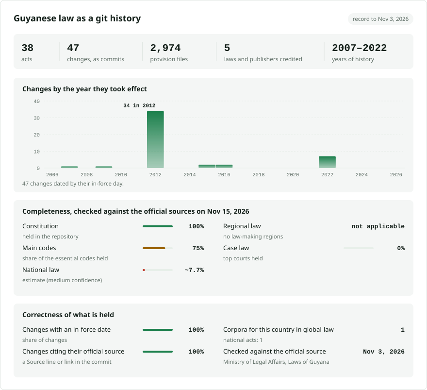

# Guyana: law history in git

<picture>
<source media="(prefers-color-scheme: dark)" srcset="data/effort-dark.svg">

</picture>

The law of Guyana as a git history: one file per article or section, one commit per version on the day it took effect, and the law that made each change as the commit's author. `git blame` names the law behind every paragraph; `git log` lists every change to a provision; picking a date gives the text in force that day.

Part of [lexifina/global-law](https://github.com/lexifina/global-law), one git history for every country's law: this is Guyana's national law, which global-law reads at `guyana/national/acts/`.

**What is in it now:** 38 texts with 47 versions: the Constitution in 6 versions, from 2007 to 2022; 35 other chapters of the Laws of Guyana, four of them (the Criminal Law (Offences), High Court, Evidence and Defamation Acts) in both the 2012 and the 2022 revised editions; and the Constitution (Amendment) Acts 2015 and 2016 as enacted. [`REPRODUCE.md`](REPRODUCE.md) lists every act with its versions; each act's `README.md` lists its provisions and when they changed.

Each act has its own folder, one file per article or section: `constitution/sch-3.md` is the Third Schedule of the Constitution (Cap. 1:01), the bodies with financial autonomy, and `labour/sec-005.md` is section 5 of the Labour Act (Cap. 98:01).

The text is in English, Guyana's official language, as the Ministry of Legal Affairs' revised editions and the Official Gazette print it.

## Questions as git commands

| Question | Command |
| --- | --- |
| Every change to the Third Schedule of the Constitution | `git log -p --word-diff -- constitution/sch-3.md` |
| Which law wrote each line of the Third Schedule? | `git blame constitution/sch-3.md` |
| Every version of the Constitution, with the day each took effect | `git log --format="%h %(trailers:key=In-force,valueonly,separator=) %an" -- constitution ':!constitution/README.md'` |
| The Third Schedule as in force on 1 January 2016 | `python tools/in_force_on.py 2016-01-01 constitution sch-3` |

**Outside git**, we also host this record publicly, for free:

- **[Ask Claude about Guyanese law](https://global-law.lexifina.com/v1/try_claude?country=guyana)**: opens Claude with a first question ready.
- **[Ask ChatGPT](https://global-law.lexifina.com/v1/try_chatgpt?country=guyana)**: the same question in ChatGPT.
- **[Search Guyanese law on our site](https://lexifina.com/law?country=guyana&q=annual+leave)**: a search for "annual leave", with each provision's text and its versions, no account needed.
- **[Developer REST API](https://global-law.lexifina.com/v1/search_law?query=annual+leave&jurisdiction=guyana)**: the same search as JSON, with no key. See the [documentation here](https://lexifina.com/api/global-law).

Both assistants read the record through the free Global law connector (MCP, `https://global-law.lexifina.com/mcp`); the first time, the chat gives you the link that adds it. Ask in English.

**Host it yourself easily.** All it takes is git and Python, and the tools run on your machine:

```sh
git clone --depth 1 https://github.com/lexifina/global-law && cd global-law
python3 tools/countries.py add guyana/national/acts
python3 tools/law.py show 2026-01-01 guyana/national/acts/constitution/sch-3.md
```

Opened in Claude Code, Cursor, VS Code or Codex, the clone also starts a local MCP server with the same tools ([MCP.md](https://github.com/lexifina/global-law/blob/main/MCP.md)).

## Dates

Each commit is dated at noon, America/Guyana, on the day the version took effect, and carries it in its `In-force:` trailer:

- for an Act, the day of its Gazette issue, as the Gazette print gives it (Interpretation and General Clauses Act, Cap. 2:01, s. 15: an Act comes into operation on publication unless it provides otherwise); Acts 5 of 2009, 2 of 2015 and 1 of 2016 name no other day;
- for a revised edition, the day the Ministry of Legal Affairs gives as its revision date: 31 December 2012 for L.R.O. 1/2012 and 31 December 2022 for L.R.O. 1/2022 (Law Revision Act, Cap. 2:02, s. 9);
- the Domestic Violence Act and the Status of Children Act are dated from their commencement (31 December 1996 and 31 May 2010) by correction commits appended later (`Kind: correction`), which the tools apply to the days in their `Corrects:` range.

Each change is credited to the Act whose own text inserts exactly those words (`Act No. 1 of 2016`). The first version of each chapter, the oldest text online, and every difference between editions that no Act explains are credited to the publisher (`Ministry of Legal Affairs, Laws of Guyana`), labelled "oldest version available" or "unexplained" (in 2012, for example, the Constitution was rewritten in gender-neutral terms); the two amendment Acts are credited to `Parliament of Guyana`, and corrections to `Lexifina`.

## How it is checked

- `tools/check_repo.py` reads every version back from git on the day it took effect and on the day before, and compares it with the corpus: 47 versions of 38 acts, 0 mismatches (see [`REPRODUCE.md`](REPRODUCE.md)).
- Every word of the latest version of each chapter, the Constitution included, is in the PDF the Ministry of Legal Affairs serves today, and every word that PDF prints is in the repository, except what is left out on purpose (running heads, marginal notes, headings), as `tools/verify_chapters.py` checks. Every version carries the sha256 of the PDF it was read from.
- The words the three Acts inserted in the Constitution were checked against the Gazette print.
- No merge commits, nothing dated in the future, and every commit's trailers parse; corrections are appended as new commits.

## What it does not show

- **Most Guyanese law.** Only these 38 texts: no other chapter, no subsidiary legislation and no case law.
- **History before the oldest text online.** The Constitution of 1980 as enacted and five amending laws are not online, so its history starts with the 2010 consolidation (in force 28 August 2007); the other chapters start with a revised edition, and amendments a later edition includes (such as Acts 1 of 2014, 13 of 2018 and 15 of 2021 in the Evidence Act) are dated with that edition, not on their own day.
- **Acts printed only as scans.** Act 12 of 2021 (Civil Law Act, s. 5(1)(b)), Acts 4 of 2023 and 11 of 2024 (Criminal Law (Procedure) Act), Act 13 of 2024 (Matrimonial Causes Act) and Act 21 of 2024 (Wills Act) have no text layer and no model may write legal text, so they are not applied: on those points these files are **not the law in force**.
- **Other later amendments.** The Parliament's index of Acts has gaps (1977 to 1980, 1991 and 2002 are missing), so other chapters may have amendments that no source online shows.
- **Marginal notes, headings and images.** Marginal notes are left out, except in the Domestic Violence and Status of Children Acts and the two amendment Acts; Part, Chapter and cross-headings, and the flag and coat of arms in the Constitution's Second Schedule, are not reproduced.

## Sources

| Source | Kind | Past versions | Notes |
| --- | --- | --- | --- |
| [Laws of Guyana](https://www.mola.gov.gy/laws-of-guyana) (Ministry of Legal Affairs) | Official revised edition, one PDF per chapter | no, only the current edition (L.R.O. 1/2022, or 1/2012 where still served) | Today's text and each chapter's list of amending laws |
| [Acts of Parliament](https://parliament.gov.gy/publications/acts-of-parliament/) (Parliament of Guyana) | Acts as published in the Official Gazette, 1928 to 2025 | as published | The amending Acts and their Gazette days |
| [Internet Archive](https://web.archive.org/) | Earlier editions | yes, as captured | The 2010 consolidation of the Constitution and L.R.O. 1/2012 |

## Licence

See [`LICENSE`](LICENSE). Neither source states a licence; the texts are official legal texts of Guyana, reproduced with attribution, and their copyright status is not confirmed. Lexifina's arrangement, commit messages, tables and tools are CC0 1.0.

No model wrote, translated or corrected legal text; the scripts were written by AI models (Claude Opus 5.5 and GPT-6), as [`REPRODUCE.md`](REPRODUCE.md) records.

## More

From [lexifina/global-law](https://github.com/lexifina/global-law):

- [FEATURES.md](https://github.com/lexifina/global-law/blob/main/FEATURES.md): every feature, and what every corpus must support (`git blame`, `law.py`, the MCP tools)
- [FAQ.md](https://github.com/lexifina/global-law/blob/main/FAQ.md): questions and answers · [CONTRIBUTING.md](https://github.com/lexifina/global-law/blob/main/CONTRIBUTING.md): proposing changes · [MCP.md](https://github.com/lexifina/global-law/blob/main/MCP.md): the MCP server · [REPRODUCE.md](https://github.com/lexifina/global-law/blob/main/REPRODUCE.md): how it was built · [CHANGELOG.md](https://github.com/lexifina/global-law/blob/main/CHANGELOG.md)
- [FRESHNESS.md](https://github.com/lexifina/global-law/blob/main/FRESHNESS.md): how current each corpus is · [Monitoring](https://github.com/lexifina/global-law/tree/main/monitoring): whether updates are running · [WATCHING.md](https://github.com/lexifina/global-law/blob/main/WATCHING.md): how each official source is watched for changes
- [performance/](https://github.com/lexifina/global-law/tree/main/performance): how fast the tools are, measured
- [visualisations/](https://github.com/lexifina/global-law/tree/main/visualisations): charts and bridges across the world's law
- [Vulnerabilities](https://github.com/lexifina/global-law/tree/main/vulnerabilities): mistakes in legislation as published
